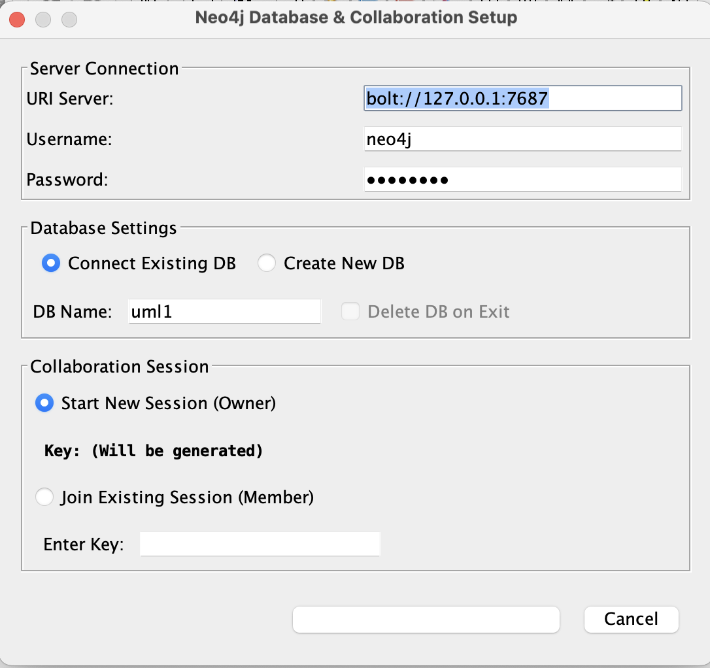
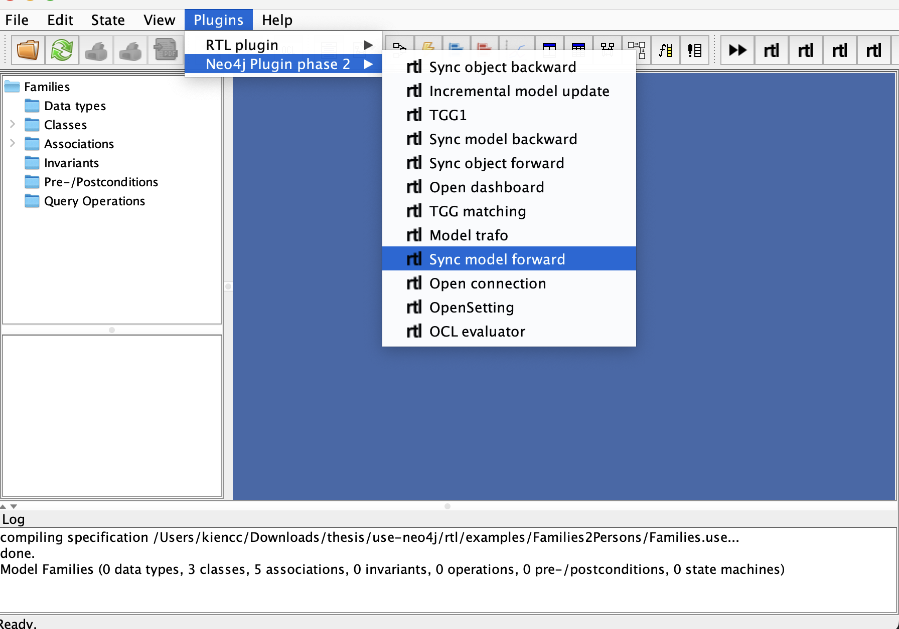
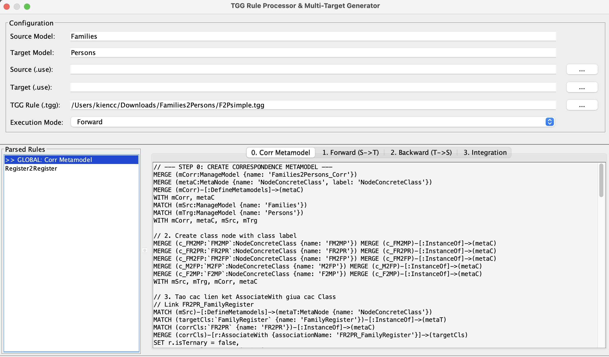
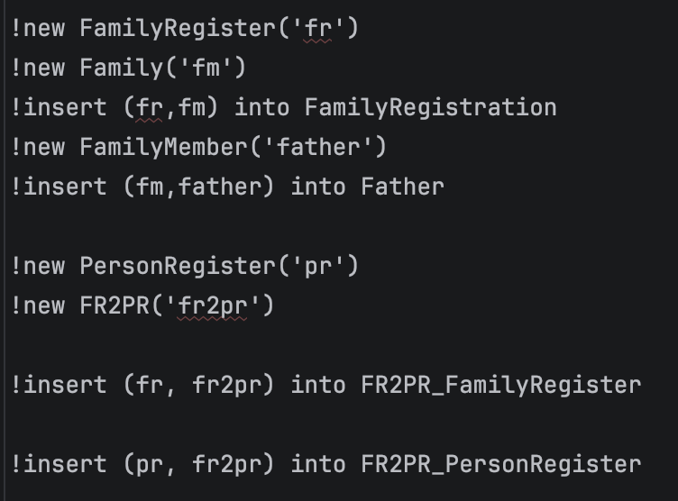
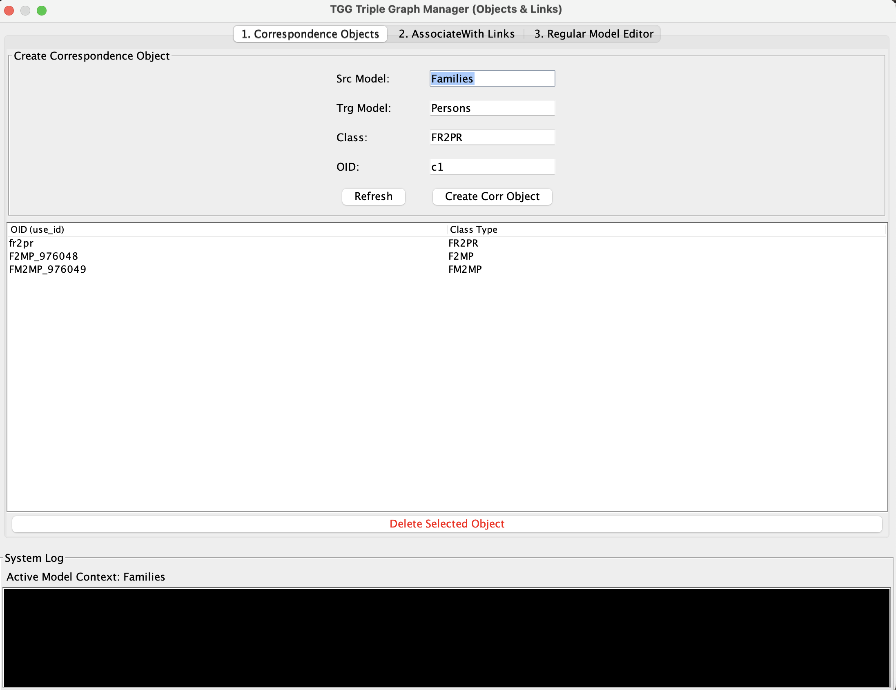
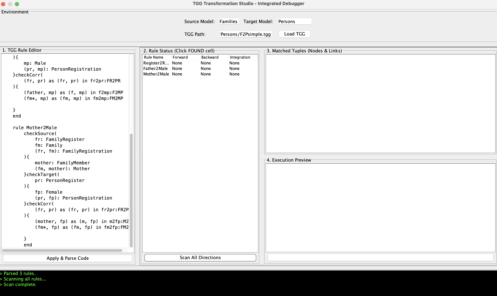

How to run TGG-Cypher?

- Set up Neo4j DB on your local device first! Or having stuff on cloud if you are rich
- Connect USE instance to the DB

- Push Family model and Person model to Neo4j first

- Go to Model trafo to create correspondence graph in neo4j. Copy the script and run in Neo4j desktop, or terminal, anything
  
- After this you should see a new model in neo4j linking Family and Person

- Go to "TGG1" to prepare environment data for the rule you want to test, can take a look on this script. Be aware that main obj should be created as main obj, corr obj should be created as corr obj as well

- Go to TGG matching, load the tgg file (again) and Scan. Check if your rule have the "Found" status. Select the data in the right section to get the execution query. Run it to execute the rule, as well as creating new node and edge in Neo4j.

- Go to Neo4j to check your output

Congrats! 
